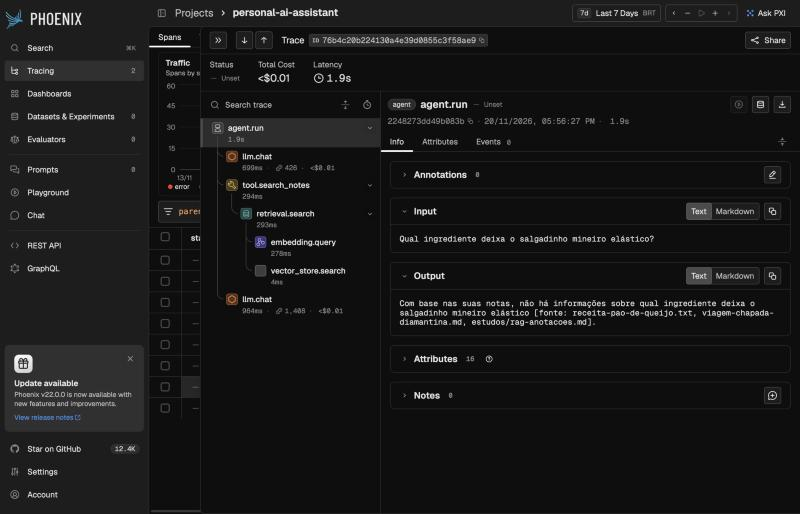
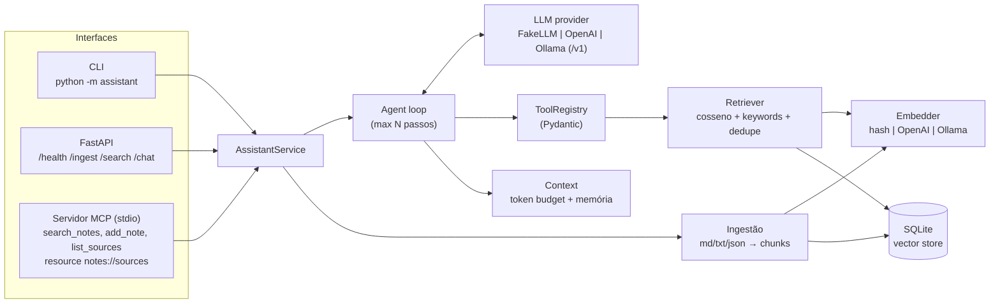

# Personal AI Assistant — RAG + MCP

Assistente pessoal de estudos em Python que responde perguntas sobre **notas pessoais**
usando **RAG** (Retrieval-Augmented Generation), um **agente com tool/function calling**,
uma **API REST** (FastAPI) e um **servidor MCP** (Model Context Protocol) que permite usar
as mesmas ferramentas direto no Claude Desktop / Claude Code.

> **Transparência sobre este projeto**
> Este repositório foi criado em **novembro de 2026**, **com assistência de IA (Claude Code)**,
> como projeto de **estudo e portfólio**. Ele **não é derivado de nenhum trabalho de cliente
> ou empregador**. Todos os documentos em `data/sample/` são **fictícios** (nomes de pessoas
> e do grupo de estudos são inventados). Os resultados de testes e as saídas mostradas abaixo
> foram copiados de execuções reais; não há métricas de qualidade de retrieval inventadas.

## Problema

Anotações de estudo, planos e atas ficam espalhados em vários arquivos. Buscar por palavra
exata é limitado e um LLM sozinho não conhece essas notas (e pode inventar respostas).

## Solução

1. **Ingestão**: lê `.md`, `.txt` e `.json`, divide em chunks com overlap e gera embeddings.
2. **Vector store em SQLite**: vetores salvos como JSON; similaridade de cosseno com numpy.
3. **Retrieval híbrido leve**: cosseno + sobreposição de palavras-chave (rerank simples) e
   remoção de chunks quase duplicados.
4. **Agente**: o LLM decide chamar ferramentas (`search_notes`, `add_note`, `list_sources`,
   `get_current_date`) no formato de tool calling da OpenAI, com no máximo N passos,
   validação de argumentos com Pydantic e erros devolvidos ao modelo para ele corrigir.
   As respostas citam as fontes (`[fonte: arquivo]`).
5. **Gestão de contexto**: contagem aproximada de tokens, orçamento de contexto para os
   trechos recuperados, janela de histórico + resumo acumulado (rolling summary).
6. **Interfaces**: CLI, API REST e servidor MCP (stdio) compartilhando a mesma camada de serviço.

Tudo roda **offline e sem chave de API** por padrão: embeddings por hashing (bag-of-words)
e um `FakeLLM` determinístico. OpenAI e Ollama são opcionais via variáveis de ambiente.


### Evolução 1 — embeddings semânticos e pgvector (20/11/2026)

- **Embeddings do Gemini** (`gemini-embedding-001`, 768 dimensões, `taskType` diferente para documento e pergunta, normalização, lotes e nova tentativa em 429/5xx).
- **PostgreSQL + pgvector** com índice HNSW, escolhido por `VECTOR_STORE=pgvector`. O SQLite continua como padrão sem servidor.
- **Comparação real** com 6 perguntas que não repetem as palavras das notas (`scripts/compare_embeddings.py`): hashing acertou **4/6** no 1º lugar; Gemini acertou **6/6**.
- Guia de estudo: [docs/estudo/01-embeddings-e-pgvector.md](docs/estudo/01-embeddings-e-pgvector.md).

### Evolução 2 — avaliação do RAG (20/11/2026)

- **Conjunto de referência** com 24 perguntas em 4 categorias (direta, paráfrase, multi-fonte e sem resposta), em `data/eval/golden.jsonl`.
- **Métricas de busca** (hit@1, hit@4, recall@4, MRR) e **de resposta** (fatos presentes, citação, abstenção), além de **LLM como juiz** para fidelidade (alucinação) e corretude.
- **Portão de qualidade no CI:** a avaliação da busca roda a cada push e reprova abaixo de hit@4 0,9 ou MRR 0,8.
- **Resultados da busca** (21 perguntas com resposta): hashing hit@1 0,81 e MRR 0,87; Gemini hit@1 **0,95** e MRR **0,98**.
- **Resultados das respostas** (24 perguntas; `gemini-3.5-flash-lite` avaliado por `gemini-3.5-flash`): fidelidade **5,0/5** (nenhuma alucinação), corretude **4,83/5**, admitiu não saber nas **3/3** perguntas sem resposta. Única falha: uma paráfrase em que a busca acertou e o modelo foi literal demais.
- Relatórios: [docs/eval/](docs/eval/).
- Guia de estudo: [docs/estudo/02-avaliacao-do-rag.md](docs/estudo/02-avaliacao-do-rag.md).

### Evolução 3 — observabilidade (20/11/2026)



- **OpenTelemetry** em cada pergunta: spans de agente, chamada ao LLM, ferramenta, busca, embedding e banco vetorial, com as convenções `gen_ai.*` e OpenInference.
- **Tokens, custo e latência** por pergunta, visíveis no trace, nos logs JSON (`trace_id`), na resposta da API `/chat` e nos relatórios de avaliação.
- **Arize Phoenix** local em Docker para ver os traces; também exporta para arquivo JSONL, com o resumo `scripts/trace_report.py`.
- **Números reais** (8 perguntas, Gemini + pgvector): latência p50 **1,96 s** e p95 **2,21 s**; custo estimado **US$ 0,00078 por pergunta** (cerca de US$ 0,78 por mil); o LLM é **84%** do tempo e a busca no pgvector, 4 ms.
- Guia de estudo: [docs/estudo/03-observabilidade.md](docs/estudo/03-observabilidade.md).

## Arquitetura



## Stack usada

| Item | Uso |
|---|---|
| Python 3.12 | linguagem |
| Pydantic 2 | validação de argumentos das tools e dos modelos da API |
| numpy | similaridade de cosseno |
| SQLite (`sqlite3` da stdlib) | vector store persistente |
| FastAPI + Uvicorn | API REST |
| `mcp` 2.x (SDK oficial) | servidor MCP via stdio (no SDK 2.x, `FastMCP` passou a se chamar `MCPServer`) |
| httpx | chamadas ao Ollama |
| `openai` (extra opcional) | LLM/embeddings OpenAI ou endpoint compatível |
| pytest, ruff, GitHub Actions | qualidade e CI |

Versões instaladas no ambiente em que os testes foram executados: mcp 2.3.0, fastapi 0.165.0,
pydantic 2.14.4, numpy 2.5.5 (macOS, Python 3.12.16).

## Estrutura

```
src/assistant/
  __main__.py      # CLI
  config.py        # Settings via variáveis de ambiente
  chunking.py      # chunks por palavras com overlap
  embeddings.py    # HashingEmbedder (offline), OpenAIEmbedder, OllamaEmbedder
  store.py         # vector store SQLite
  ingest.py        # leitura de md/txt/json e indexação incremental (hash do conteúdo)
  retrieval.py     # busca híbrida + dedupe
  context.py       # contagem de tokens, orçamento, memória da conversa
  llm.py           # OpenAIChatLLM e FakeLLM
  tools.py         # ferramentas + validação Pydantic
  agent.py         # loop de tool calling
  service.py       # camada compartilhada
  api.py           # FastAPI
  mcp_server.py    # servidor MCP
data/sample/       # notas fictícias em português
tests/             # pytest (unidade, agente, API, MCP)
```

## Como rodar

Pré-requisito: Python 3.12.

```bash
python3.12 -m venv .venv
source .venv/bin/activate
pip install -e ".[dev]"          # adicione ,openai para usar OpenAI: ".[dev,openai]"
cp .env.example .env              # opcional; os padrões já funcionam offline
```

> Os comandos abaixo leem variáveis de ambiente do shell. O arquivo `.env` é só um modelo:
> carregue-o com `set -a; source .env; set +a` se quiser usá-lo.

### 1. Ingestão das notas de exemplo

```bash
python -m assistant ingest
```

Saída real (primeira execução; numa segunda execução os 6 arquivos aparecem como "sem mudança"):

```
Arquivos: 6 | indexados: 6 | sem mudança: 0 | chunks novos: 8 | total de chunks no banco: 8
```

### 2. Perguntar ao agente (modo offline, `LLM_PROVIDER=fake`)

```bash
python -m assistant ask "Qual a temperatura do forno para o pão de queijo?"
```

```
Pelas suas notas:
- Receita: pão de queijo de liquidificador (versão da caderneta) [fonte: receita-pao-de-queijo.txt]
- Asse em forno pré-aquecido a 200 °C por 25 a 30 minutos, até dourar. [fonte: receita-pao-de-queijo.txt]
- 1 xícara de queijo meia cura ralado [fonte: receita-pao-de-queijo.txt]
```

Com `--json` aparecem as fontes e as chamadas de ferramenta:

```bash
python -m assistant ask "Quem ficou responsável pelos testes no grupo?" --json
```

```json
{
  "answer": "Pelas suas notas:\n- Bruno fica responsável pelo pipeline de ingestão; Carla pelos testes; Ana pela API. [fonte: reuniao-grupo-estudos.md]\n- Ata — Grupo de Estudos \"Vetores\" (grupo fictício) [fonte: reuniao-grupo-estudos.md]\n- Escolha do projeto final do grupo. [fonte: reuniao-grupo-estudos.md]",
  "sources": [
    "reuniao-grupo-estudos.md"
  ],
  "steps": 2,
  "tool_calls": [
    {
      "name": "search_notes",
      "arguments": "{\"query\": \"Quem ficou responsável pelos testes no grupo?\", \"k\": 3}",
      "ok": true
    }
  ]
}
```

> O `FakeLLM` **não é um modelo de linguagem**: ele escolhe a ferramenta por regras simples e
> monta uma resposta **extrativa** (frases dos trechos recuperados com mais termos em comum com
> a pergunta). Por isso às vezes inclui uma frase pouco útil, como o título do documento. Ele
> existe para que testes e demo rodem sem chave de API. Para respostas geradas de verdade, use
> `LLM_PROVIDER=openai` ou `LLM_PROVIDER=ollama`.

Busca direta, sem LLM:

```bash
python -m assistant search "Morro do Pai Inácio" -k 2
```

```
[0.426] viagem-chapada-diamantina.md#0: # Plano de viagem: Chapada Diamantina (rascunho) **Período:** 12 a 18 de julho **Base:** Lençóis (BA…
```

(Só 1 resultado voltou porque os demais ficaram abaixo do score mínimo de 0.05.)

### 3. API REST

```bash
python -m assistant serve-api --port 8101     # padrão: 127.0.0.1:8101
```

Em outro terminal:

```bash
curl -s 127.0.0.1:8101/health
# {"status":"ok","version":"0.1.0","chunks_indexed":8,"embedder":"hash-bow-1024","llm_provider":"fake"}

curl -s -X POST 127.0.0.1:8101/search -H 'Content-Type: application/json' \
  -d '{"query": "polvilho azedo", "k": 2}'
# {"results":[{"source":"receita-pao-de-queijo.txt","chunk_index":0,"text":"Receita: pão de queijo ...","score":0.44}]}
# (texto do chunk abreviado aqui)

curl -s -X POST 127.0.0.1:8101/chat -H 'Content-Type: application/json' \
  -d '{"message": "Quem ficou responsável pelos testes no grupo?"}'
# devolve session_id, answer, sources, steps e tool_calls; reenvie o session_id para manter o histórico
```

Entradas inválidas retornam `422` (ex.: `{"query": "a"}`), caminho inexistente em `/ingest`
retorna `404`, e falhas de configuração do LLM em `/chat` retornam `503`. Cada requisição gera
um log JSON em stderr com `request_id`, `method`, `path`, `status` e `duration_ms`, e a resposta
traz o header `x-request-id`.

### 4. Servidor MCP

```bash
python -m assistant serve-mcp     # stdio; normalmente quem inicia é o cliente MCP
```

Ferramentas expostas: `search_notes(query, k)`, `add_note(title, content)`, `list_sources()`.
Resource: `notes://sources` (JSON com os documentos indexados).

Exemplo de configuração para o **Claude Desktop** (`claude_desktop_config.json`) ou para o
**Claude Code** (`.mcp.json` no projeto). Use caminhos absolutos:

```json
{
  "mcpServers": {
    "personal-notes": {
      "command": "/CAMINHO/ABSOLUTO/personal-ai-assistant-rag-mcp/.venv/bin/python",
      "args": ["-m", "assistant", "serve-mcp"],
      "env": {
        "ASSISTANT_DB_PATH": "/CAMINHO/ABSOLUTO/personal-ai-assistant-rag-mcp/assistant.sqlite3"
      }
    }
  }
}
```

No Claude Code também dá para registrar pela linha de comando:

```bash
claude mcp add personal-notes \
  -e ASSISTANT_DB_PATH=/CAMINHO/ABSOLUTO/assistant.sqlite3 \
  -- /CAMINHO/ABSOLUTO/.venv/bin/python -m assistant serve-mcp
```

Rode `python -m assistant ingest` antes, para o banco ter conteúdo. A integração foi testada
automaticamente com o cliente do próprio SDK (`tests/test_mcp.py`, in-process e via subprocesso
stdio); **a conexão manual pelo Claude Desktop não foi testada** neste ambiente.

### Provedores opcionais

| Variável | Valores | Padrão |
|---|---|---|
| `EMBEDDING_PROVIDER` | `hash`, `openai`, `ollama` | `hash` |
| `LLM_PROVIDER` | `fake`, `openai`, `ollama` | `fake` |
| `OPENAI_API_KEY` / `OPENAI_BASE_URL` | chave / URL de endpoint compatível | vazio |
| `OLLAMA_BASE_URL` | URL do Ollama | `http://localhost:11434` |
| `LLM_MODEL` / `EMBEDDING_MODEL` | nome do modelo | `gpt-4o-mini`/`text-embedding-3-small` (OpenAI), `llama3.1`/`nomic-embed-text` (Ollama) |

Trocar o embedder exige apagar o banco e reindexar (o store guarda o nome do embedder e
recusa misturar vetores de modelos diferentes).

## Testes

```bash
ruff check .
pytest -q
pytest -q tests/test_mcp.py     # só os testes MCP
```

Resultados reais obtidos em 20/11/2026 (macOS, Python 3.12.16):

```
ruff check .                                  -> All checks passed!
pytest -q                                     -> 63 passed, 4 skipped
TEST_DATABASE_URL=.../rag_test pytest -q   -> 67 passed
```

Os 4 testes de pgvector só rodam com `TEST_DATABASE_URL` definida (banco `rag_test`, criado pelo `docker compose -p rag-mcp up -d pgvector`); no CI há um serviço pgvector e eles sempre rodam.

O que os testes cobrem: chunking/overlap, embeddings determinísticos, vector store e rejeição de
embedder diferente, retrieval e dedupe, orçamento de tokens e memória, validação das tools,
loop do agente com `FakeLLM` (incluindo recuperação após erro de argumento, limite de passos e
citação automática de fontes), endpoints da API via `TestClient` e o servidor MCP (in-process e
via stdio), o embedder do Gemini com API falsa (lotes, `taskType`, normalização, nova tentativa em 429) e o
PgVectorStore num PostgreSQL real. A CI (`.github/workflows/ci.yml`) roda `ruff check` e `pytest` em Python 3.12
com um serviço pgvector.

## Implementado vs. planejado

| Funcionalidade | Status |
|---|---|
| Ingestão md/txt/json, chunking com overlap, reindexação incremental | Implementado |
| Embeddings offline (hashing) | Implementado e testado |
| Embeddings Gemini (`gemini-embedding-001`) | Implementado e testado com a API real (comparação 6/6) |
| Embeddings OpenAI / Ollama | Implementado, **não testado** com serviço real |
| Vector store SQLite + cosseno (numpy) | Implementado |
| Vector store PostgreSQL + pgvector com índice HNSW | Implementado e testado (local e CI) |
| Retrieval híbrido (cosseno + keywords) e dedupe | Implementado (rerank simples, sem BM25 completo) |
| Agente com tool calling, validação Pydantic, max passos, citações | Implementado e testado com `FakeLLM` |
| LLM OpenAI / Ollama (endpoint compatível) | Implementado, **não testado** com serviço real |
| Orçamento de tokens, janela de histórico, rolling summary | Implementado (contagem aproximada; resumo extrativo) |
| API REST (/health, /ingest, /search, /chat) com logs JSON | Implementado e testado |
| Servidor MCP (stdio) com tools + resource | Implementado e testado com o cliente do SDK |
| Avaliação de busca e de respostas (golden set, métricas, LLM como juiz, portão no CI) | Implementado; respostas avaliadas com Gemini |
| LLM Gemini (`LLM_PROVIDER=gemini`, endpoint compatível com OpenAI) | Implementado e testado com a API real |
| Observabilidade: traces OpenTelemetry, tokens, custo, latência, Phoenix | Implementado e testado (local e com a API real) |
| Resumo da conversa gerado pelo LLM | Planejado |
| Persistência das sessões de chat da API | Planejado (hoje ficam em memória) |
| Autenticação na API | Planejado |

## Limitações

- O embedder por hashing é lexical, não semântico: sinônimos não são encontrados (use `EMBEDDING_PROVIDER=gemini`).
- No modo SQLite, a busca carrega todos os vetores na memória a cada consulta (ok para centenas/poucos
  milhares de chunks). Para bases grandes, use `VECTOR_STORE=pgvector`.
- Com o Gemini, a cota gratuita limita o volume de ingestão por dia.
- Contagem de tokens aproximada (~4 caracteres por token).
- `add_note` salva a nota apenas no banco, não em arquivo.
- Sessões do `/chat` vivem em memória e se perdem ao reiniciar.
- A avaliação das respostas usa a cota gratuita do Gemini; com 24 perguntas e juiz, leva vários minutos.
- O conjunto de referência é pequeno (24 perguntas) e foi escrito pela autora; não cobre todos os tipos de pergunta.

## Próximos passos

1. Usar a avaliação para comparar versões do prompt e do chunking.
2. Adicionar BM25 de verdade e comparar com o rerank atual usando o portão de qualidade.
3. Trocar o resumo extrativo por um resumo gerado pelo LLM.

## Licença

MIT — veja [LICENSE](LICENSE).
